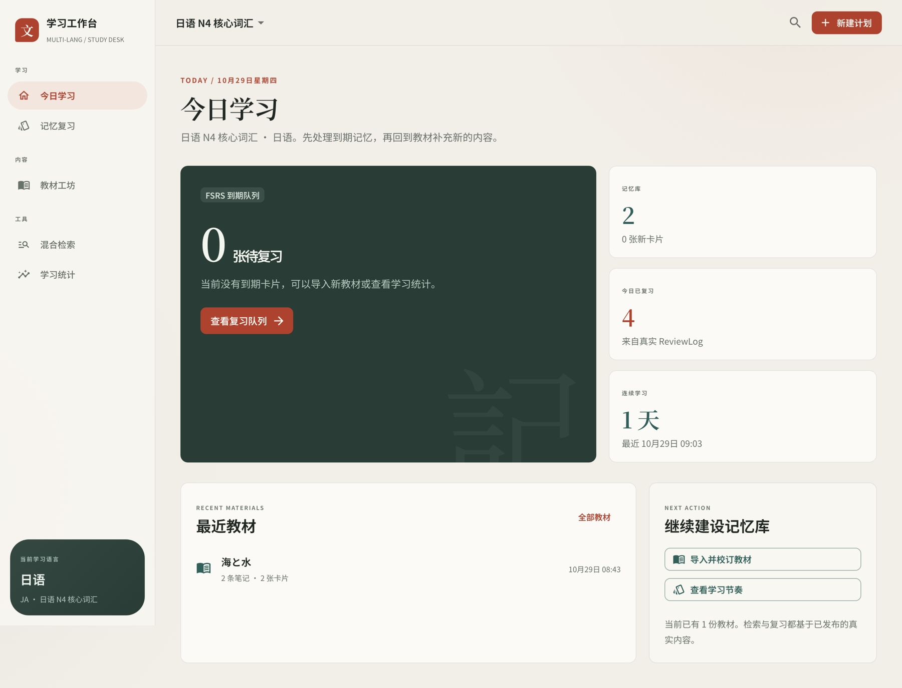

# 多语言学习工作台

> 把教材，变成会按时回来的记忆。

面向英语与日语的自托管学习工作台：导入教材、人工校订、在同一事务里写入 seekdb 检索文档，再用 FSRS 安排下一次复习。所有进度来自真实 `ReviewLog`，没有演示曲线。

- 项目网站：https://multi-lang-study-desk-x2wqb4wmi6j.qoder.zone
- 代码仓库：https://github.com/mugaaaaa/multi-lang
- 技术栈：TypeScript · React · Vite · Hono · seekdb · mysql2 · ts-fsrs
- 赛题：OceanBase 2026 · Qoder 赛道



## 1. 项目简介

学习材料通常散落在文档、网页、笔记和记忆软件之间。这个项目把「教材 → 校订 → 发布 → 检索 → 复习 → 统计」收进同一个工作台，并只使用 seekdb 一个数据库。

首版支持英语与日语。语言差异由语言插件提供，通用学习流程、事务和权限留在内核；新增语言不需要在核心路由里增加语言分支。

## 2. 解决的问题

- **教材进不来**：Markdown 教材解析为安全 AST，先预览再发布，确认后才生成卡片与检索文档。
- **复习靠意志**：FSRS 根据真实评分计算 `stability`、`difficulty` 与 `dueAt`，到期队列只包含真正到期的卡片。
- **找到了却不知道出处**：检索结果附来源文档与修订号，教材段落、笔记和卡片可以回到原文。
- **进度不可信**：累计复习、保持率、连续学习与 14 天节奏全部来自 `review_logs` 和调度状态；没有记录就留白。

## 3. 核心功能

- 教材导入与人工校订：Markdown → 安全 AST → 草稿预览 → 显式发布。
- seekdb 全文检索：业务文本与 `search_documents` 同事务写入；`MATCH ... AGAINST` 参数化查询。
- 语言插件：英语 `space` 分词、日语 `ngram` 分词；NoteType、规范化与检索配置随插件注册。
- FSRS 复习：`ts-fsrs` 调度，评分写入只追加的 `review_logs`。
- 真实统计：累计复习、今日复习、保持率、连续天数与 14 天节奏直接从数据库聚合。
- Web 微内核：`AppShell` 独占布局，插件只向 route、sidebar、headerAction 三类贡献点注册；五个通用页面也由内置插件装配。

## 4. 技术架构

```text
Browser (React + Vite)
        │  /v1
        ▼
Hono API ──► Domain services ──► Storage (mysql2 参数化 SQL) ──► seekdb
        ▲
        │
DefaultPluginRegistry
  ├─ language-en / language-ja
  ├─ importer-markdown
  └─ scheduler-fsrs
```

关键边界：

- 只使用 seekdb 一个数据库，不引入 PostgreSQL 或独立 MySQL。
- 发布教材、笔记、卡片与检索文档在同一个事务中提交；失败一起回滚。
- 插件只提供语言元数据、纯函数与配置，不返回 SQL 字符串，不直接写数据库。
- 业务文本与检索文档同事务发布；Embedding 预留异步处理，但当前尚未实现向量检索。

## 5. seekdb 如何参与

- **单库承载**：计划、教材、笔记、卡片、调度状态、复习日志与检索文档共 11 张表。
- **检索**：`search_documents` 保存教材段落和笔记的检索文本；日语使用 `ngram`，英语使用 `space`，由语言插件的 `searchConfig` 决定列选择。
- **事务**：发布时同时写入 `source_blocks`、`notes`、`cards` 与 `search_documents`，避免“正文写入但检索不到”的半成品。
- **时间**：连接池统一使用 UTC，到期判断使用 `UTC_TIMESTAMP(3)`，修复了 seekdb 会话时区与 Node 进程时区漂移导致的口径差。
- **真实验证**：日语计划中检索「海」，命中学习笔记与教材段落，相关度分别为 `0.400`、`0.350`、`0.231`，来源修订均为 `1`；随后 2 张卡片完成 2 轮评分，统计为累计复习 4、保持率 100%、连续 1 天。

当前只启用全文检索；Embedding Worker 与向量检索尚未实现，`search_documents.embedding_status` 保持 `pending`。

## 6. 插件化

- Server 入口：语言包、Markdown 导入器、FSRS 调度器都通过 `DefaultPluginRegistry` 在 `apps/api/src/main.ts` 组合注册。
- Web 入口：`WebPluginRegistry` 校验插件、路由、侧边栏与头部动作的重复 ID；`AppShell` 按当前计划语言过滤贡献点，并在路由入口校验语言上下文。
- 通用页面不是硬编码进 `AppShell`，而是由内置插件 `multi-lang.builtin.learning` 通过同一套贡献点注册。
- 语言插件可在存在真实语言专属页面或动作时提供 `web` 入口；当前英语/日语没有专属页面，因此保留 `src/web` 槽位而不预造空实现。

## 7. 快速开始

环境要求：Node.js 22+、pnpm 10、Docker（或 OrbStack）。首次启动 seekdb 需要几分钟完成初始化。

```bash
# 1. 启动 seekdb
docker compose -f infra/seekdb/docker-compose.yml up -d

# 2. 安装依赖并迁移
cp .env.example .env
# 按需修改 .env 中的本地密码占位值
pnpm install
pnpm migrate

# 3. 两个终端分别启动
pnpm dev:api   # http://localhost:8787
pnpm dev:web   # http://localhost:5173
```

环境变量模板见 `.env.example`，不要提交真实密码或 API Key。MVP 为单用户模式，`ownerId` 由服务端从 `DEV_OWNER_ID` 注入。

展示站源码在 `apps/showcase`：

```bash
pnpm build:showcase
python3 -m http.server 4173 --directory apps/showcase/dist
```

## 8. 验证样例

1. 打开 `http://localhost:5173`，新建「日语 N4 核心词汇」。语言选项来自 `GET /v1/languages`。
2. 在教材工坊粘贴：

```markdown
# 海と水

海についての短い教材です。

| 海 | うみ、大海 |
```

3. 解析草稿并确认发布。预期教材工坊出现 `2` 段、`2` 条笔记、`2` 张卡片。
4. 在混合检索输入「海」。预期命中一条学习笔记与两条教材段落，显示来源修订与相关度。
5. 在记忆复习中完成两轮评分。预期统计页出现真实的累计复习、保持率与 14 天节奏。

详细验证记录见 `docs/sprint1/mvp-plan.md` 第 7、8 节。

## 9. 目录结构

```text
apps/
  api/          Hono API 与组合入口
  web/          React 学习工作台
  showcase/     赛题项目展示站（纯静态）
packages/
  contracts/    共享 DTO 与类型
  domain/       领域服务与端口
  plugin-sdk/   插件契约与注册表
  storage/      seekdb 迁移、仓储与检索
plugins/
  language-en/  英语语言包
  language-ja/  日语语言包
  importer-markdown/
  scheduler-fsrs/
docs/sprint1/   设计与 MVP 实施记录
infra/seekdb/   seekdb 容器配置
```

## 10. 当前限制

- 检索只覆盖全文；Embedding Worker 与向量检索未实现。
- MVP 为单用户，无认证中间件；`ownerId` 由服务端注入。
- 普通 CRUD 使用 mysql2 手写参数化 SQL，Drizzle 依赖尚未启用。
- 英语/日语暂无语言专属 Web 页面，`src/web` 槽位保留。

## 11. 提交材料

- 项目网站：https://multi-lang-study-desk-x2wqb4wmi6j.qoder.zone
- 代码仓库：https://github.com/mugaaaaa/multi-lang
- 运行说明：本文件第 7 节
- 验证样例：本文件第 8 节
- Qoder 开发记录：见赛题提交材料包中的 4 张关键截图（设计决策、插件原则与开工、语言插件设计、真实 seekdb 验证与时区修复）
- Qoder 账号 UID：见赛题平台提交信息

Qoder 对话截图包含账号界面，不放入公开仓库，统一放在提交材料包中。
